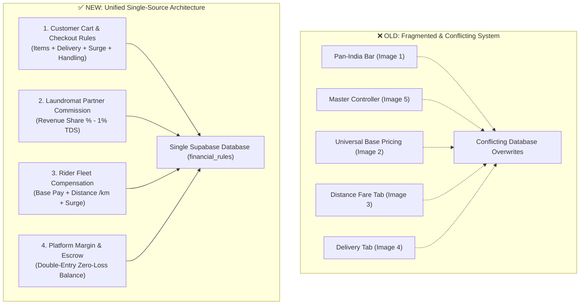
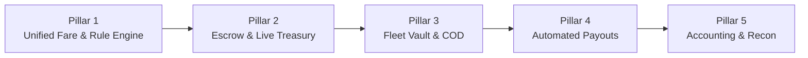

# QuickPress Unified Enterprise Finance Engine — Architecture & De-Duplication Roadmap

> [!IMPORTANT]
> **Executive Summary:** This roadmap establishes a **Single Source of Truth** for the entire QuickPress financial system. It eliminates all overlapping, redundant, and conflicting controls across the Admin Console, creating an enterprise-grade, fraud-proof, and real-working financial infrastructure.

---

## 1. Problem Identification: Why Duplication Occurred & What is Fixed

In the previous versions of the Admin Console, 5 separate UI components contained overlapping and conflicting inputs for the same business variables:

| Setting | Where it Appeared (Conflicting Instances) | Conflicting Values Found | Unified Single-Source Solution |
| :--- | :--- | :--- | :--- |
| **Delivery / Fare Slabs** | 1. Master Controller (Card 2)<br>2. Base Pricing Tab<br>3. Distance Fare Tab (Image 3)<br>4. Delivery Engine Tab (Image 4) | Base pay: ₹25 vs ₹35 vs ₹99<br>Per km: ₹6 vs ₹7 vs ₹8 | **Split into 2 Explicit Entities:**<br>• **Customer Delivery Fee** (What customer pays at checkout)<br>• **Rider Transit Pay** (What rider gets paid for driving) |
| **Surge Pricing** | 1. Pan-India Bar (Image 1)<br>2. Master Controller (Card 4)<br>3. Delivery Engine Tab (Image 4) | Rain surge: ₹15 vs ₹20 vs ₹25<br>Night surge: ₹20 vs ₹25 | **Unified Dynamic Surge Engine:**<br>Single toggle with auto-triggers (Rain, Peak Hours, High Demand) |
| **Handling / Convenience Fee** | 1. Master Controller (Card 3)<br>2. Base Pricing Tab (Image 2) | Order Handling: ₹2<br>Platform Convenience: ₹5 | **Unified Platform Technology Fee:**<br>Single line item at checkout (e.g., ₹5 fixed) |
| **Free Delivery Threshold** | 1. Pan-India Bar (Image 1)<br>2. Master Controller (Card 6)<br>3. Delivery Engine Tab (Image 4) | Minimum order: ₹149 vs ₹499 | **Unified Cart Threshold:**<br>Single rule (Orders $\ge$ ₹X get 100% Free Delivery, else flat ₹Y fee) |



---

## 2. The Core Financial Formula (Zero Ambiguity)

In QuickPress, an order involves **three distinct parties** and the **platform**. The money flows mathematically without any overlap:

$$\text{Customer Total Inflow} = \text{Garment Items Subtotal} + \text{Customer Delivery Fee} + \text{Handling Fee} + \text{Packaging} + \text{Surge} - \text{Discount}$$

### How that money is distributed:
1. **Laundromat Partner Share:**
   $$\text{Partner Earning} = (\text{Garment Items Subtotal} \times \text{Partner Payout \%}) - \text{1\% Section 194-O TDS}$$
   *(Note: Partner only earns on the clothes cleaning, not on delivery or handling!)*

2. **Rider Captain Share:**
   $$\text{Rider Pay} = \text{Rider Base Fare} + (\text{Trip KM} \times \text{Rider Per-KM Rate}) + \text{Rider Surge Bonus}$$

3. **QuickPress Platform Retained Margin (Net Gross Profit):**
   $$\text{Platform Margin} = (\text{Garment Items Subtotal} \times \text{Platform Commission \%}) + \text{Handling Fee} + (\text{Customer Delivery Fee} - \text{Rider Pay})$$

---

## 3. The Unified 5-Pillar Finance Engine Roadmap



### Pillar 1: Single Unified Pricing & Fare Controller
*Eliminates images 1, 2, 3, 4, 5 duplicates into one master control panel:*
1. **Customer Order Pricing:**
   - **Universal Garment Tariff Catalog:** Base price per service (Dry Clean, Steam Press, Wash & Fold) managed in Services.
   - **Customer Delivery Surcharge:** 
     - Free delivery threshold (e.g., Free on orders $\ge$ ₹199).
     - Below-threshold flat delivery fee (e.g., ₹29).
   - **Platform Technology Fee:** Single fixed checkout fee (e.g., ₹5).
   - **Protective Packaging Fee:** Optional toggle (e.g., ₹0 or ₹10).
2. **Laundromat Commercials:**
   - **Partner Payout Share:** 85% to Partner, 15% Platform Commission.
   - **Volume Tiers:** High-volume partners (1000+ orders/month) can get 88% payout.
3. **Rider Logistics Fare Slabs:**
   - **Base Transit Pay:** ₹25 (covers first 2 km).
   - **Distance Rate:** ₹7 per additional km.
   - **Express Bonus:** +₹20 for 24h rapid priority turnaround.
4. **Dynamic Surge Triggers:**
   - **Rain / Water-logging Surge:** +₹20 (automatically passed to riders).
   - **Peak Late-Night Surge:** +₹25 (active 10:00 PM – 06:00 AM).

---

### Pillar 2: Real-Time Cashflow & Escrow Architecture
*How customer money is protected from fraud and payment disputes:*
- **Advance Online Payments (UPI / Card / NetBanking):**
  - Held in a **Platform Escrow Sub-Wallet** upon checkout.
  - Money is **NOT** released to the partner or rider until the delivery confirmation OTP is entered by the customer.
- **Immediate Cancellation / Refund:**
  - If an order is cancelled before pickup, 100% refund is credited back to the customer's original payment method or QuickPress Wallet instantly within 30 seconds.

---

### Pillar 3: Fleet Vault & COD Clearance
*Eliminates rider cash theft and physical collection delays:*
- **Rider Cash Float Cap:**
  - Every rider has a maximum allowed cash-in-hand limit (e.g., ₹2,500).
  - Once a rider collects ₹2,500 in COD orders, **no new COD orders can be assigned** to them until they deposit the cash at their assigned Hub.
- **Hub Handover Verification:**
  - Hub Manager scans the rider's QR code on the Partner App to accept the physical cash.
  - The rider's float instantly clears to ₹0, unlocking them for new orders.

---

### Pillar 4: Automated Disbursals & Maker-Checker Settlement
*Enterprise banking integration without manual Excel sheets:*
- **Settlement Cycles:**
  - Standard Partner Settlement: **T+2 Days** (or weekly every Monday).
  - Rider Earnings: **Daily Instant Payout** (at 11:00 PM).
- **Maker-Checker Security Protocol:**
  - **Maker (Finance / Operations Associate):** Generates and reviews the pending payout batch.
  - **Checker (Super Admin):** Enters 2FA / Password to authorize the final bank disbursement.
- **Bank Gateway Integration:**
  - Automated payout webhooks via **RazorpayX** or **Cashfree Payouts API** direct to verified bank accounts / UPI IDs.

---

### Pillar 5: Statutory Compliance, 3-Way Recon & GAAP Reporting
*Corporate compliance for MCA, Income Tax, and Investors:*
- **3-Way Automated Reconciliation:**
  - Gateway Settlement Files (Razorpay) $\leftrightarrow$ QuickPress Order Ledger $\leftrightarrow$ Bank Account Statements.
  - Tolerance of 0% variance (zero penny leakage).
- **Statutory Taxes Auto-Deduction:**
  - **GST (18%):** Automatically partitioned into 9% CGST + 9% SGST on platform commission and delivery fees.
  - **TDS Section 194-O (1%):** Deducted from gross e-commerce payments made to laundromat partners and credited under their PAN.
- **Automated Financial Statements:**
  - Monthly Profit & Loss (P&L) statement.
  - Double-Entry General Ledger journal entries.
  - Exportable GSTR-1 and GSTR-3B tax schedules.

---

## 4. Single-Source Database Contract (`financial_rules`)

All duplicate fields are consolidated into one single JSONB schema in the Supabase PostgreSQL database:

```json
{
  "customer_rules": {
    "free_delivery_min_order": 199.00,
    "below_threshold_delivery_fee": 29.00,
    "handling_fee": 5.00,
    "packaging_fee": 0.00,
    "rain_surge": 20.00,
    "night_surge": 25.00,
    "is_surge_active": false
  },
  "partner_rules": {
    "standard_payout_percent": 85.0,
    "platform_commission_percent": 15.0,
    "tds_percent": 1.0,
    "settlement_frequency": "T_PLUS_2"
  },
  "rider_rules": {
    "base_fare": 25.00,
    "base_distance_km": 2.0,
    "extra_km_rate": 7.00,
    "express_bonus": 20.00,
    "waiting_free_minutes": 10,
    "waiting_rate_per_min": 2.00,
    "cod_cash_limit": 2500.00
  }
}
```

---

## 5. Implementation Action Plan

| Phase | Milestone | Expected Result |
| :---: | :--- | :--- |
| **Phase 1** | Remove Duplicate Bar (`PanIndiaQuickControlBar`) | **Completed & Pushed to GitHub `main`** |
| **Phase 2** | Consolidate Master Rules into 3 Clean Columns (Customer, Partner, Rider) | Eliminates duplicate inputs between Master Controller and Sub-Tabs |
| **Phase 3** | Connect Live Database to Single-Source State | Changing any rule instantly syncs to mobile apps via live Supabase webhooks |
| **Phase 4** | Activate 1-Click Form 16A TDS & RazorpayX Payout Disbursals | Fully autonomous, enterprise-grade financial operations |
